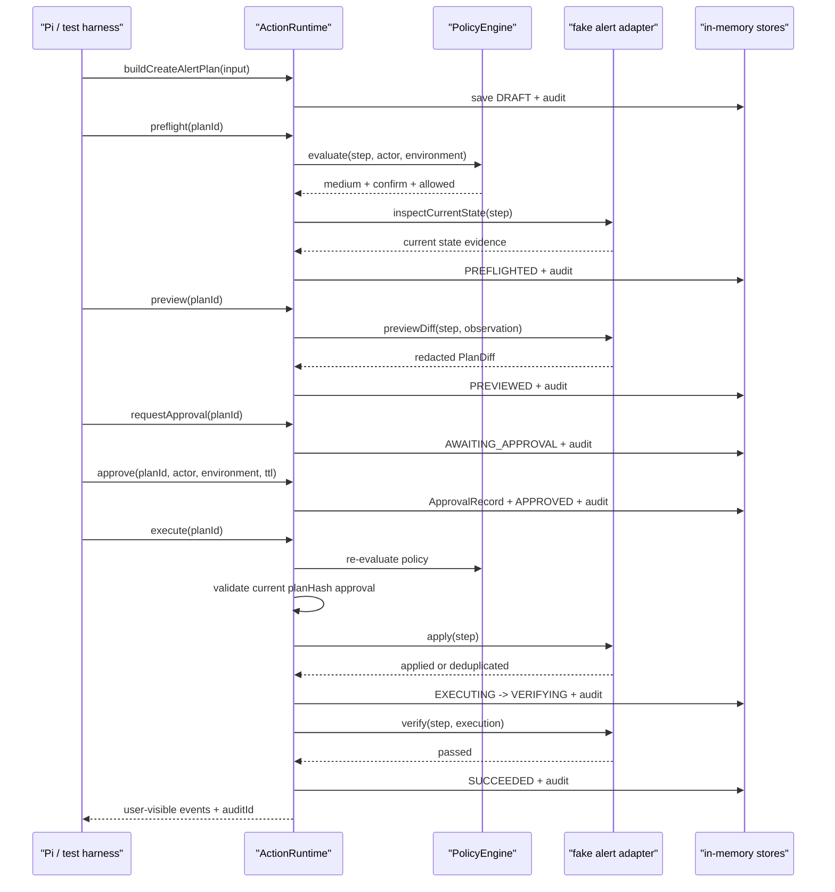

# SRE Copilot Pi Core 架构设计

> 日期：2026-08-14<br>
> 状态：待评审<br>
> 本轮边界：只完成约束、遗留系统退役方案、核心架构与第一阶段 vertical slice 设计；不实现业务代码，不连接真实系统，不安装 Pi 依赖。

## 1. 结论

新一代 SRE Copilot 应先完成 **Phase 0 遗留系统退役**，再在唯一的 `agent/` 包中建立一个与 Pi、监控厂商、SSH、Kubernetes 和具体 UI 解耦的 action runtime。Pi 只是首个 agent harness；未来 Web、企微、API 和定时任务都通过同一公开 runtime API 创建、确认和执行 `ActionPlan`。

Phase 0 不做兼容迁移：旧 `v2/`、共享 eval、旧 workflow/replay/compare、部署脚本和以旧 runtime 为主入口的文档从当前工作树移除。它们由已推送的 Git 提交 `7f81522` 保留历史，不在新结构旁继续运行。Phase 0 的完整清单和逐步验收见 `../superpowers/plans/2026-08-14-SRE-COPILOT-LEGACY-RETIREMENT-PLAN.MD`。

第一阶段只交付一条离线、可重复、可完整验收的写操作路径：

> 用户要求为 `demo-service` 创建 5xx 错误率告警 → 读取 fake adapter 当前状态 → 生成告警设计与结构化计划 → 确定性策略评估 → 展示脱敏 diff 和风险 → 绑定计划快照的确认 → 幂等执行 → 复验 → 审计与用户可见结果。

该路径建立以下不可绕过的不变量：

1. 所有写操作必须属于 `ActionPlan` 和 `ActionStep`。
2. LLM、Pi extension 和 UI 都不能直接获得 adapter 写接口。
3. 每次执行前都由确定性 `PolicyEngine` 重新计算风险与执行模式。
4. 确认绑定 `planId + planHash + actor + environment + expiresAt`。
5. 计划、目标、参数、风险、执行模式或 diff 变化后，旧确认立即失效。
6. 写步骤必须声明前置条件、预期效果、复验和回滚或人工补偿方案。
7. adapter 必须以 `idempotencyKey` 去重，并拒绝同键不同载荷。
8. adapter 返回“已执行”后仍必须复验；只有复验通过才能进入 `SUCCEEDED`。
9. 任何状态变化都写入审计；用户可见事件只来自明确允许的字段。
10. 凭证和原始敏感材料停留在 adapter 边界内，不进入计划、模型上下文或审计摘要。

## 2. 产品范围

### 2.1 长期定位

SRE Copilot 是具备“观测、设计、变更、发布、复验”能力的 SRE 操作 Agent。长期能力包括 telemetry 查询、监控配置、代码 telemetry 分析、代码变更、测试、发布、变更日历与故障时间线关联。

### 2.2 Phase 0：干净基线

第一阶段业务实现开始前，仓库必须满足：

1. `v2/`、`eval/` 及旧 replay/compare/workflow runtime 已删除。
2. 根 `package.json`、Makefile、Docker、部署脚本和本地服务脚本不再暴露旧入口。
3. 旧配置、知识样例和历史运行文档只保留在 Git 历史，不作为活跃资产留在工作树。
4. `README.MD`、根工作清单、`docs/DOCS-INDEX.MD` 和 `AGENTS.MD` 只描述新的 `agent/` 路线。
5. `npm run clean:start:verify` 可以从干净 checkout 离线证明以上约束。
6. `docs/verification/LEGACY-RETIREMENT-ACCEPTANCE.MD` 记录实际删除范围、验证结果和历史锚点。

Phase 0 是 Phase 1 的强制门禁，不允许与 Phase 1 混合提交，也不允许为了兼容旧入口保留桥接层。

### 2.3 第一阶段范围

第一阶段只实现以下九个动作，并只服务于“创建 `demo-service` 5xx 告警策略”：

1. `inspectCurrentState`
2. `buildPlan`
3. `evaluatePolicy`
4. `previewDiff`
5. `requestApproval`
6. `execute`
7. `verify`
8. `writeAuditEvent`
9. `renderUserVisibleEvents`

第一阶段只使用 fake alert adapter 和内存存储。所有测试离线执行，不依赖 LLM、网络、数据库、历史报告或真实身份系统。

### 2.4 第一阶段明确不做

- 不连接 BK Monitor、Kubernetes、SSH、Git、CI/CD、企微和生产系统。
- 不恢复、兼容或引用已在 Phase 0 退役的 `v2/`、旧 eval、replay、compare、workflow 和部署入口。
- 不实现多租户、分布式锁、持久队列、真实 RBAC 和跨进程恢复。
- 不承诺所有写操作都能自动回滚。
- 不让 Pi 或 LLM 获得任意 shell、SSH 或底层 adapter 写权限。
- 不把后续阶段的真实 adapter、代码修改或发布能力放进第一阶段实施计划。

## 3. 架构原则与信任边界

### 3.1 分层

```text
Pi / Web / WeCom / API / Scheduler
                 |
                 v
        Public Core Runtime API
                 |
      +----------+-----------+
      |                      |
      v                      v
Action Runtime          Policy Engine
      |                      |
      +----------+-----------+
                 |
                 v
          Adapter Registry
                 |
        first phase: fake alert
                 |
      +----------+-----------+
      v                      v
 Evidence / Artifacts   Audit / User Events
```

依赖方向固定为：

- `contracts` 不依赖其他业务层。
- `policy` 只依赖 `contracts`。
- `runtime` 依赖 `contracts`、`policy`、audit/evidence ports，不依赖 Pi 或具体平台 SDK。
- `adapters` 实现 `contracts` 中的 `SreAdapter`，但 runtime 只通过接口调用。
- `capabilities` 负责特定资源的计划构建，不把场景判断塞进通用 runtime。
- Pi integration 只能调用 `agent/src/index.ts` 暴露的公开 API。

### 3.2 控制面与数据面

- `ActionPlan`、policy、approval、state machine 和 audit 属于控制面。
- adapter 的 observe/apply/verify/rollback 属于受控数据面。
- runtime 是唯一能够把控制面决策转换为 adapter 调用的组件。
- adapter 不接受自然语言指令，只接受通过 schema 校验的结构化 `ActionStep`。
- 模型只能提出计划候选；确定性验证、策略与确认门禁决定能否进入执行。

### 3.3 凭证边界

`ActionPlan.params` 不允许保存 Token、Cookie、密码、Authorization Header、SSH key、kubeconfig 路径或完整敏感日志。真实 adapter 后续通过运行时注入的 `credentialRef` 向进程内 secret broker 取值；runtime、LLM 和 audit 只能看到不含秘密的引用标识与脱敏摘要。第一阶段 fake adapter 不使用凭证。

## 4. 最终目录设计

Phase 0 完成后，仓库只保留新路线所需的根文档、TypeScript 工具链、设计/计划/验收入口和一个 clean-start guard。Phase 1 在此基线上新增下列 `agent/` 目录；每个文件只有一个主要职责：

```text
agent/
├── package.json                         # 独立离线验证入口，复用根目录已安装的 TS 工具
├── tsconfig.json                        # agent 包严格 TypeScript 配置
├── src/
│   ├── contracts/
│   │   ├── common.ts                    # JSON、标识、actor、environment 等基础类型
│   │   ├── action-plan.ts               # ActionPlan、ActionStep、状态与步骤约束
│   │   ├── results.ts                   # diff、确认、策略、执行、复验、回滚结果
│   │   ├── evidence.ts                  # EvidenceItem 与 ArtifactRef
│   │   ├── events.ts                    # AuditEvent 与 UserVisibleStepEvent
│   │   ├── adapter.ts                   # CapabilityDefinition 与 SreAdapter port
│   │   └── index.ts                     # 合同层统一导出
│   ├── runtime/
│   │   ├── errors.ts                    # 失败码与安全错误归一化
│   │   ├── state-machine.ts             # 合法状态迁移
│   │   ├── plan-hash.ts                 # 稳定序列化与 SHA-256 计划指纹
│   │   ├── approval-gate.ts             # 确认创建、撤销和执行前校验
│   │   ├── in-memory-stores.ts           # 第一阶段 plan/approval/audit 内存存储
│   │   └── action-runtime.ts             # 生命周期编排和 adapter 调用门禁
│   ├── policy/
│   │   └── policy-engine.ts              # 风险与执行模式的确定性计算
│   ├── capabilities/
│   │   └── alerts/
│   │       └── build-create-alert-plan.ts # demo 5xx 告警结构化计划构建
│   ├── adapters/
│   │   └── fake-alert-adapter.ts         # fake 告警 observe/diff/apply/verify 与幂等表
│   ├── evidence/
│   │   └── redact.ts                     # 敏感键和值的递归脱敏
│   ├── audit/
│   │   └── render-user-events.ts         # 审计事件到用户可见事件的白名单投影
│   └── index.ts                          # Pi 等 harness 可调用的唯一公开入口
└── tests/
    ├── support/fixtures.ts               # 固定时钟、actor、environment 与告警计划 fixture
    ├── contracts.test.ts                 # 合同枚举与序列化约束
    ├── plan-hash.test.ts                 # hash 稳定性与计划变更失效
    ├── state-machine.test.ts              # 主路径和异常状态迁移
    ├── policy-engine.test.ts              # 风险、执行模式与 deny 条件
    ├── approval-gate.test.ts              # hash/actor/environment/有效期确认门禁
    ├── fake-alert-adapter.test.ts         # 幂等写入、冲突与复验
    ├── user-visible-events.test.ts        # 脱敏和内部思维字段隔离
    └── action-runtime.test.ts             # 完整 happy path 与失败路径
```

`.pi/` 是明确的后续接入点，但第一阶段不创建 extension，也不安装 Pi 依赖：

```text
.pi/
├── extensions/
│   └── sre-copilot.ts  # 后续只导入 agent/src/index.ts 的公开 API
└── skills/
    └── sre-copilot/    # 后续只描述能力与交互，不保存执行凭证
```

## 5. 核心领域合同

以下是第一阶段应落地的完整 TypeScript 合同草案。`DRAFT` 中的 `riskLevel` 与 `executionMode` 可以为 `null`；进入 `PREFLIGHTED` 前必须由 `PolicyEngine` 填充，LLM 不得写入最终值。

```ts
export type JsonPrimitive = string | number | boolean | null;
export type JsonValue = JsonPrimitive | JsonObject | JsonValue[];
export interface JsonObject { [key: string]: JsonValue }

export type OperationKind =
  | 'observe'
  | 'analyze_code'
  | 'design'
  | 'change'
  | 'release'
  | 'verify'
  | 'rollback';

export type ExecutionMode = 'auto' | 'confirm' | 'advice_only' | 'deny';
export type RiskLevel = 'read' | 'low' | 'medium' | 'high' | 'critical';
export type MutationType =
  | 'none'
  | 'create'
  | 'update'
  | 'delete'
  | 'release'
  | 'execute_remote';

export type ActionPlanStatus =
  | 'DRAFT'
  | 'PREFLIGHTED'
  | 'PREVIEWED'
  | 'AWAITING_APPROVAL'
  | 'APPROVED'
  | 'EXECUTING'
  | 'VERIFYING'
  | 'SUCCEEDED'
  | 'BLOCKED'
  | 'FAILED'
  | 'ROLLBACK_REQUIRED'
  | 'ROLLING_BACK'
  | 'ROLLED_BACK';

export type ActionStepStatus =
  | 'PENDING'
  | 'READY'
  | 'RUNNING'
  | 'APPLIED'
  | 'VERIFYING'
  | 'SUCCEEDED'
  | 'BLOCKED'
  | 'FAILED'
  | 'ROLLBACK_REQUIRED'
  | 'ROLLING_BACK'
  | 'ROLLED_BACK'
  | 'SKIPPED';

export interface ActorRef {
  id: string;
  type: 'user' | 'service' | 'scheduler';
  displayName: string;
}

export interface EnvironmentRef {
  name: string;
  tier: 'local' | 'development' | 'staging' | 'production';
}

export interface TimeWindow {
  start: string;
  end: string;
  timezone: string;
}

export interface ActionTarget {
  type: 'service' | 'alert_policy' | 'dashboard' | 'metric' | 'trace' | 'release';
  resourceId?: string;
  environment: EnvironmentRef;
  scope: Readonly<Record<string, string>>;
}

export interface StepPrecondition {
  id: string;
  description: string;
  check: 'resource_absent' | 'resource_matches' | 'evidence_fresh' | 'policy_allows';
  params: JsonObject;
}

export interface ExpectedEffect {
  description: string;
  resourceType: string;
  resourceId: string;
  desiredState: JsonObject;
}

export interface VerificationSpec {
  id: string;
  description: string;
  capability: string;
  assertion: 'resource_exists' | 'resource_matches' | 'signal_within_range';
  params: JsonObject;
}

export interface RollbackPlan {
  mode: 'automatic' | 'manual' | 'compensation' | 'none';
  supported: boolean;
  capability?: string;
  params?: JsonObject;
  instructions: readonly string[];
  verification: readonly VerificationSpec[];
}

export interface ActionStep {
  id: string;
  kind: OperationKind;
  capability: string;
  capabilityVersion: string;
  target: ActionTarget;
  params: JsonObject;
  mutates: boolean;
  mutationType: MutationType;
  riskLevel: RiskLevel | null;
  executionMode: ExecutionMode | null;
  preconditions: readonly StepPrecondition[];
  expectedEffects: readonly ExpectedEffect[];
  verification: readonly VerificationSpec[];
  rollback: RollbackPlan;
  idempotencyKey: string;
  dependencies: readonly string[];
  status: ActionStepStatus;
}

export interface PlanDiffChange {
  path: string;
  operation: 'add' | 'replace' | 'remove';
  before: JsonValue | null;
  after: JsonValue | null;
}

export interface PlanDiff {
  id: string;
  stepId: string;
  target: ActionTarget;
  before: JsonObject | null;
  after: JsonObject | null;
  changes: readonly PlanDiffChange[];
  redacted: boolean;
  generatedAt: string;
}

export interface ApprovalRecord {
  id: string;
  planId: string;
  planHash: string;
  actor: ActorRef;
  environment: EnvironmentRef;
  decision: 'approved' | 'rejected';
  issuedAt: string;
  expiresAt: string;
  revokedAt?: string;
  revocationReason?: 'plan_changed' | 'policy_changed' | 'actor_revoked';
}

export interface PolicyFactor {
  name: 'capability' | 'environment' | 'operation' | 'resource_scope' | 'mutation_type';
  value: string;
  risk: RiskLevel;
}

export interface PolicyDecision {
  id: string;
  planId: string;
  stepId: string;
  policyVersion: string;
  allowed: boolean;
  riskLevel: RiskLevel;
  executionMode: ExecutionMode;
  factors: readonly PolicyFactor[];
  reasonCodes: readonly string[];
  evaluatedAt: string;
  expiresAt: string;
}

export interface ArtifactRef {
  id: string;
  kind: 'diff' | 'observation' | 'execution_receipt' | 'verification_report';
  uri: string;
  mediaType: string;
  sha256: string;
  redacted: boolean;
  createdAt: string;
}

export interface EvidenceItem {
  id: string;
  type: 'current_state' | 'policy' | 'execution' | 'verification';
  source: string;
  summary: string;
  observedAt: string;
  window?: TimeWindow;
  sensitivity: 'public' | 'internal' | 'confidential';
  digest: string;
  artifactRefs: readonly string[];
}

export interface SafeRuntimeError {
  code:
    | 'INVALID_TRANSITION'
    | 'POLICY_DENIED'
    | 'APPROVAL_REQUIRED'
    | 'APPROVAL_INVALID'
    | 'PRECONDITION_FAILED'
    | 'IDEMPOTENCY_CONFLICT'
    | 'ADAPTER_ERROR'
    | 'VERIFICATION_FAILED';
  message: string;
  retryable: boolean;
}

export interface ExecutionResult {
  stepId: string;
  adapterId: string;
  idempotencyKey: string;
  status: 'applied' | 'deduplicated' | 'failed';
  resourceRef?: string;
  evidence: readonly EvidenceItem[];
  artifacts: readonly ArtifactRef[];
  startedAt: string;
  finishedAt: string;
  error?: SafeRuntimeError;
}

export interface VerificationCheckResult {
  verificationId: string;
  passed: boolean;
  expected: JsonValue;
  actual: JsonValue;
  message: string;
}

export interface VerificationResult {
  stepId: string;
  status: 'passed' | 'failed' | 'blocked';
  checks: readonly VerificationCheckResult[];
  evidence: readonly EvidenceItem[];
  artifacts: readonly ArtifactRef[];
  startedAt: string;
  finishedAt: string;
  error?: SafeRuntimeError;
}

export interface ActionPlan {
  schemaVersion: '1.0';
  id: string;
  revision: number;
  planHash: string;
  policyVersion: string;
  actor: ActorRef;
  environment: EnvironmentRef;
  objective: string;
  status: ActionPlanStatus;
  steps: readonly ActionStep[];
  diffs: readonly PlanDiff[];
  policyDecisions: readonly PolicyDecision[];
  evidence: readonly EvidenceItem[];
  artifacts: readonly ArtifactRef[];
  approvalIds: readonly string[];
  auditId: string;
  createdAt: string;
  updatedAt: string;
}

export type AuditEventType =
  | 'PLAN_CREATED'
  | 'PLAN_REVISED'
  | 'STATE_CHANGED'
  | 'POLICY_EVALUATED'
  | 'DIFF_PREVIEWED'
  | 'APPROVAL_REQUESTED'
  | 'APPROVAL_RECORDED'
  | 'APPROVAL_REVOKED'
  | 'STEP_STARTED'
  | 'STEP_FINISHED'
  | 'VERIFICATION_FINISHED'
  | 'BLOCKER_RECORDED';

export interface AuditEvent {
  id: string;
  auditId: string;
  planId: string;
  planHash: string;
  type: AuditEventType;
  fromStatus?: ActionPlanStatus;
  toStatus?: ActionPlanStatus;
  stepId?: string;
  actor: ActorRef;
  environment: EnvironmentRef;
  capability?: string;
  redactedInputSummary?: string;
  outcome: 'info' | 'allowed' | 'denied' | 'success' | 'failure';
  reasonCodes: readonly string[];
  evidenceRefs: readonly string[];
  artifactRefs: readonly string[];
  durationMs?: number;
  occurredAt: string;
}

export interface UserVisibleStepEvent {
  id: string;
  planId: string;
  auditId: string;
  phase: ActionPlanStatus;
  stepId?: string;
  status: 'pending' | 'running' | 'waiting' | 'success' | 'failure' | 'blocked';
  message: string;
  target?: ActionTarget;
  capability?: string;
  redactedInputSummary?: string;
  queryWindow?: TimeWindow;
  durationMs?: number;
  diff?: PlanDiff;
  riskLevel?: RiskLevel;
  approvalStatus?: 'not_required' | 'waiting' | 'approved' | 'expired' | 'revoked';
  blocker?: { code: string; message: string };
  verification?: VerificationResult;
  evidenceRefs: readonly string[];
  artifactRefs: readonly string[];
  auditEventId: string;
  recommendedNextStep?: string;
  occurredAt: string;
}

export interface CapabilityDefinition {
  id: string;
  version: string;
  adapterId: string;
  operations: readonly OperationKind[];
  mutationTypes: readonly MutationType[];
  targetTypes: readonly ActionTarget['type'][];
  allowedEnvironmentTiers: readonly EnvironmentRef['tier'][];
  defaultExecutionMode: ExecutionMode;
  riskByMutation: Readonly<Partial<Record<MutationType, RiskLevel>>>;
  supportsRollback: boolean;
}

export interface ObservationResult {
  stepId: string;
  currentState: JsonObject | null;
  evidence: readonly EvidenceItem[];
  artifacts: readonly ArtifactRef[];
  observedAt: string;
}

export interface AdapterExecutionContext {
  planId: string;
  planHash: string;
  actor: ActorRef;
  environment: EnvironmentRef;
  credentialRef?: string;
  now: string;
}

export interface SreAdapter {
  readonly id: string;
  readonly capabilities: readonly CapabilityDefinition[];
  inspectCurrentState(
    context: AdapterExecutionContext,
    step: ActionStep,
  ): Promise<ObservationResult>;
  previewDiff(
    context: AdapterExecutionContext,
    step: ActionStep,
    observation: ObservationResult,
  ): Promise<PlanDiff>;
  apply(
    context: AdapterExecutionContext,
    step: ActionStep,
  ): Promise<ExecutionResult>;
  verify(
    context: AdapterExecutionContext,
    step: ActionStep,
    execution: ExecutionResult,
  ): Promise<VerificationResult>;
  rollback?(
    context: AdapterExecutionContext,
    step: ActionStep,
    rollback: RollbackPlan,
  ): Promise<ExecutionResult>;
}
```

## 6. ActionPlan 状态机

### 6.1 主路径

```text
DRAFT
  -> PREFLIGHTED
  -> PREVIEWED
  -> AWAITING_APPROVAL
  -> APPROVED
  -> EXECUTING
  -> VERIFYING
  -> SUCCEEDED
```

各状态不变量：

| 状态 | 必须成立 |
|---|---|
| `DRAFT` | 计划合同有效，尚未允许写执行 |
| `PREFLIGHTED` | capability、目标、前置条件和最新 policy decision 均有效；步骤风险和模式已确定 |
| `PREVIEWED` | 所有写步骤都有基于当前状态生成的脱敏 diff |
| `AWAITING_APPROVAL` | planHash 已覆盖最终步骤定义、风险、执行模式和 diff |
| `APPROVED` | 存在未过期且匹配当前 planHash/actor/environment 的确认 |
| `EXECUTING` | 执行前 policy 与确认已再次校验，依赖步骤满足 |
| `VERIFYING` | 所有本次需要写入的步骤已获得 execution result |
| `SUCCEEDED` | 每个写步骤的 verification result 都是 `passed` |

### 6.2 异常路径

| 来源 | 条件 | 目标 |
|---|---|---|
| `DRAFT` / `PREFLIGHTED` / `PREVIEWED` / `AWAITING_APPROVAL` / `APPROVED` | 缺 capability、越权目标、策略拒绝、确认不可用 | `BLOCKED` |
| 非终态 | runtime 或 adapter 在无外部副作用时失败 | `FAILED` |
| `EXECUTING` / `VERIFYING` | 已产生外部副作用，但执行或复验未满足预期 | `ROLLBACK_REQUIRED` |
| `ROLLBACK_REQUIRED` | 由授权操作者启动受支持回滚或人工补偿 | `ROLLING_BACK` |
| `ROLLING_BACK` | 回滚/补偿复验通过 | `ROLLED_BACK` |
| `ROLLING_BACK` | 回滚/补偿失败 | `FAILED` |

`SUCCEEDED`、`ROLLED_BACK` 是终态。第一阶段不自动调用 rollback；如果 fake 告警已创建但复验失败，计划进入 `ROLLBACK_REQUIRED`，并展示 `RollbackPlan` 中的人工补偿说明。

### 6.3 计划修订

计划在开始执行前允许通过 `revisePlan` 修订。修订是受控命令，不是随意修改内存对象：

1. 只允许从 `DRAFT`、`PREFLIGHTED`、`PREVIEWED`、`AWAITING_APPROVAL`、`APPROVED`、`BLOCKED` 或无外部副作用的 `FAILED` 发起。
2. `revision` 加一，更新计划语义内容并重新计算 planHash。
3. 撤销该 plan 的所有有效确认，原因写为 `plan_changed`。
4. 状态回到 `DRAFT`，重新执行 preflight、preview 和 approval。
5. 写入 `PLAN_REVISED`、`APPROVAL_REVOKED` 和 `STATE_CHANGED` 审计事件。

调用者不能通过直接修改 store 返回对象改变计划；内存 store 存取均使用深拷贝。

## 7. planHash 与确认模型

### 7.1 hash 覆盖范围

`planHash` 使用 SHA-256，对按键名稳定排序后的 approval scope 做摘要。数组保留顺序。hash 包含：

- `schemaVersion`、`id`、`revision`
- `actor` 与 `environment`
- `objective` 与 `policyVersion`
- 每个步骤除运行状态外的完整定义，包括 capability/version、target、params、mutation、risk、mode、前置条件、预期效果、复验、rollback、idempotencyKey 和 dependencies
- 所有 `PlanDiff` 的 before/after/changes

hash 不包含：

- plan/step 运行状态
- `createdAt`、`updatedAt` 和执行耗时
- audit/evidence/artifact 引用
- execution/verification 结果

这样，正常状态推进不会让确认失效，而任何用户实际确认的目标、参数、风险或 diff 变化都会产生新 hash。

### 7.2 确认校验

写操作开始前必须同时满足：

```text
approval.decision == approved
approval.planId == plan.id
approval.planHash == computePlanHash(plan)
approval.actor == current actor
approval.environment == plan.environment == current environment
approval.issuedAt <= now < approval.expiresAt
approval.revokedAt is absent
latest policy decision is allowed and not deny/advice_only
plan.status == APPROVED
```

第一阶段默认确认有效期为 10 分钟。TTL 是可注入配置，测试使用固定时钟，不依赖真实时间。

### 7.3 策略变化

执行前重新评估 policy。若 policy version 或结论发生变化：

- 新结论为 `deny`：转 `BLOCKED`。
- 风险上升或执行模式变严格：撤销确认，重新 preview，回到 `AWAITING_APPROVAL`。
- 风险下降但 planHash 不变：仍使用已绑定的原风险快照；第一阶段不自动降低门槛。

## 8. PolicyEngine

### 8.1 输入与算法

风险不是模型输出。`PolicyEngine` 只接收结构化输入并执行版本化规则：

```text
risk = max(
  capability.riskByMutation[mutationType],
  environment tier risk,
  operation risk,
  resource scope risk,
  mutation risk
)
```

风险顺序固定为：

```text
read < low < medium < high < critical
```

执行模式由确定性规则决定：

| 条件 | 模式 |
|---|---|
| policy 明确拒绝、capability 不存在、环境或 scope 不允许 | `deny` |
| 只有建议能力或 adapter 不可执行 | `advice_only` |
| 任意真实 mutation，或风险为 `medium/high/critical` | `confirm` |
| 非 mutation 且 capability 允许自动读取 | `auto` |

### 8.2 第一阶段规则

第一阶段 capability 只有 `monitor.alert.create@1.0`：

- adapter：`fake-alert`
- operation：`change`
- mutation：`create`
- target：`alert_policy`
- 环境：只允许 `{ name: 'demo', tier: 'development' }`
- scope：只允许 `service=demo-service`
- 风险：`medium`
- 执行模式：`confirm`
- 自动 rollback：不支持

以下请求必须 `deny`：

- production 或 staging 环境写操作
- 非 `demo-service` 目标
- delete、release、execute_remote mutation
- 任意 SSH/Kubernetes/真实监控 capability
- 缺失或未注册 capability

## 9. fake alert adapter

### 9.1 内部资源

fake adapter 在内存中保存：

```ts
interface FakeAlertPolicy {
  id: string;
  service: 'demo-service';
  name: string;
  expression: string;
  thresholdPercent: number;
  evaluationWindowMinutes: number;
  forMinutes: number;
  severity: 'warning';
  enabled: boolean;
}
```

第一阶段计划固定生成：

```ts
{
  id: 'alert-policy/demo-service-5xx-error-rate',
  service: 'demo-service',
  name: 'demo-service 5xx error rate',
  expression: 'sum(rate(http_requests_total{service="demo-service",status=~"5.."}[5m])) / clamp_min(sum(rate(http_requests_total{service="demo-service"}[5m])), 1) * 100',
  thresholdPercent: 5,
  evaluationWindowMinutes: 5,
  forMinutes: 10,
  severity: 'warning',
  enabled: true,
}
```

这是 fake domain 的确定性配置，不宣称等同任何真实平台查询语法。

### 9.2 observe 与 diff

- `inspectCurrentState` 按 `target.resourceId` 查找当前策略。
- 资源不存在时 `currentState=null`，并产生一条 `current_state` evidence。
- `previewDiff` 只使用已脱敏的 current/desired state。
- 新建场景生成 `add` diff；若已存在相同配置，precondition 视为已满足且 apply 返回 `deduplicated`；若同名配置不同，第一阶段阻塞而不隐式覆盖。

### 9.3 幂等

adapter 保存：

```text
idempotencyKey -> { payloadDigest, executionResult, resourceId }
```

- 同键、同 payload digest：返回原 resource，状态为 `deduplicated`。
- 同键、不同 digest：返回 `IDEMPOTENCY_CONFLICT`，不写资源。
- apply 在写表和幂等表之间使用单进程同步临界区；第一阶段不声称具备跨进程原子性。

### 9.4 复验

`verify` 必须重新读取内存资源并逐字段比较 desired state。只有资源存在且完整匹配时返回 `passed`。测试可通过 fake adapter 的故障注入选项使复验返回失败，以证明 runtime 不会错误进入 `SUCCEEDED`。

## 10. ActionRuntime 执行流



执行步骤按 `dependencies` 做拓扑排序。第一阶段只有一个写步骤，但 runtime 仍拒绝缺失依赖和环。执行时只调度 `READY` 步骤；失败后的依赖步骤标记为 `SKIPPED`。

## 11. Evidence、artifact 与 audit

### 11.1 Evidence

`EvidenceItem` 保存事实摘要、来源、时间、可选查询窗口、敏感级别和 digest。它不保存未经裁剪的原始响应。真实 adapter 后续若需保留大对象，应先脱敏并写 artifact store，计划中只保存 `ArtifactRef`。

### 11.2 Audit

每次状态变化必须产生 `STATE_CHANGED`，且 event 的 `fromStatus/toStatus` 与实际 store 更新一致。其他重要动作写专用事件。审计写入失败时，写操作不得继续：第一阶段采用内存 transaction 语义，先追加审计再公开新状态；任一步失败都不向调用方返回“已记录”。

一个 plan 使用一个 `auditId`，每条事件使用独立 `id`。事件只包含脱敏输入摘要、reason code 和 evidence/artifact 引用。

### 11.3 用户可见事件

`renderUserVisibleEvents` 使用字段白名单从 plan、diff、verification 和 audit 投影，展示：

- 当前阶段、步骤状态、目标环境和资源范围
- capability 与脱敏输入摘要
- 查询时间窗和执行耗时
- evidence/artifact 引用
- 变更前后 diff
- 风险与确认状态
- blocker、复验结果、audit ID 和推荐下一步

它不接受或输出以下字段：

- reasoning、chainOfThought、hiddenPrompt
- credential、token、cookie、password、secret、authorization
- rawLog、privateKey、kubeconfigPath
- 未经 evidence 支持的确定性根因

renderer 还会递归检查字符串中的 Bearer token、常见私钥头和 Cookie 片段，将其替换为 `[REDACTED]`。测试使用恶意输入证明这些内容不会出现在 JSON 序列化结果中。

## 12. Pi 集成边界

Pi extension 后续只能依赖 `agent/src/index.ts` 暴露的 facade：

```ts
export interface SreCoreRuntime {
  createDemoAlertPlan(input: {
    actor: ActorRef;
    environment: EnvironmentRef;
    service: 'demo-service';
  }): ActionPlan;
  preflight(planId: string): Promise<ActionPlan>;
  preview(planId: string): Promise<ActionPlan>;
  requestApproval(planId: string): ActionPlan;
  approve(input: {
    planId: string;
    actor: ActorRef;
    environment: EnvironmentRef;
    ttlMs: number;
  }): ApprovalRecord;
  reviseStepParams(planId: string, stepId: string, params: JsonObject): ActionPlan;
  execute(planId: string, actor: ActorRef, environment: EnvironmentRef): Promise<ActionPlan>;
  getUserVisibleEvents(planId: string): readonly UserVisibleStepEvent[];
}
```

Pi 负责自然语言交互、计划/diff 展示、确认 UI 和流式事件渲染。Pi 不负责风险计算、确认有效性、状态迁移、幂等或 adapter 选择。Pi tool 只能调用 facade 方法，不能拿到 `SreAdapter` 实例。

在本设计批准前：

- 不创建 `.pi/extensions/sre-copilot.ts`。
- 不安装或修改 Pi 依赖。
- 不推断 Pi SDK 的具体 API。

实施第一阶段后，再根据选定 Pi SDK 的官方接口做单独接入设计和依赖评审。

## 13. dev-observe 与 dev-ssh 的扩展位置

### 13.1 dev-observe

后续以 capability 集合接入 adapter registry：

- 日志、指标、告警、事件、Trace、元数据和仪表盘查询通常为 `observe + read + auto`。
- 告警和仪表盘配置为 `change + confirm`。
- 所有配置变更必须先 observe 当前对象，再生成 diff。
- 复验仍通过相同 adapter port 返回 `VerificationResult`。

### 13.2 dev-ssh

后续只能作为受控下钻执行器：

- 保留 wrapper、白名单、只读检查、安全预览和审计。
- Pi 和 LLM 不获得任意 SSH/bash 能力。
- 远端写操作需要新的 capability、独立策略和更高风险等级。
- 不通过扩展现有 readonly wrapper 的自由参数实现写操作。

两者都不能被 core 直接 import；只能通过注册的 `SreAdapter` 和 `CapabilityDefinition` 接入。

## 14. 第一阶段验证策略

第一阶段新增独立入口：

```bash
npm run clean:start:verify
npm run agent:typecheck
npm run agent:test
npm run agent:verify
```

`clean:start:verify` 先证明遗留 runtime、脚本和活跃文档入口没有回流。`agent:verify` 只执行 `agent/tsconfig.json` typecheck 与 `agent/tests/*.test.ts`，不调用旧 compare、网络、LLM 或历史报告。

验收映射：

| 验收项 | 测试 |
|---|---|
| `DRAFT -> SUCCEEDED` 主路径 | `action-runtime.test.ts` happy path |
| 无匹配确认拒绝写入 | `approval-gate.test.ts`、runtime no-approval case |
| 修改计划后确认失效 | `plan-hash.test.ts`、approval revision case |
| 幂等重试不重复创建 | `fake-alert-adapter.test.ts` dedup case |
| apply 结果可复验 | adapter verify passed case |
| 复验失败不成功 | runtime verification failure case |
| 每次状态变化有 audit | runtime transition/audit parity case |
| 用户事件不泄密或思维链 | `user-visible-events.test.ts` hostile payload case |
| 全部测试离线 | `agent:verify` 入口测试与 package script review |
| 遗留系统未回流 | `npm run clean:start:verify` |
| 不调用旧 compare | root `agent:verify` script 精确断言/人工审查 |

## 15. 遗留系统处置决定

旧系统只作为 Phase 0 的删除输入和 Git 历史存在，不再作为新核心的兼容基线：

- 最后一个已推送的完整旧系统快照是提交 `7f81522`，分支为 `origin/codex/pi-sre-core`。
- 旧 `v2:verify:core` 对历史 V1 replay 报告的隐式依赖证明旧验证链无法作为干净 checkout 的新基线。
- Phase 0 直接删除旧 runtime、共享 eval、replay/compare/workflow 和相关运行入口，不修补、不跳过、不复制历史报告。
- 需要查阅旧实现时使用 Git 历史；当前工作树不保留可执行副本或兼容别名。
- 新 core 的验收只依赖 `clean:start:verify` 和 `agent:verify`。

这个决定用“历史可恢复、当前结构唯一”的方式取代长期双轨。

## 16. 后续路线图

阶段顺序固定如下：

- Phase 0：完整退役遗留 runtime、工具链和活跃文档口径，建立 clean-start guard。
- Phase 1：实现 `demo-service` 5xx 告警 fake vertical slice。
- Phase 2：接入 dev-observe 只读查询和真实 evidence 模型。
- Phase 3：告警、仪表盘和监控配置写操作。
- Phase 4：代码 telemetry 分析、指标设计和 Trace 接入。
- Phase 5：代码修改、测试、发布与变更视图。
- Phase 6：变更日历和故障时间线关联。
- Phase 7：Web/企微/API、多租户、权限与生产加固。

每个阶段都必须先形成独立可验收 vertical slice，再扩展下一阶段。

## 17. 未决问题与第一阶段默认值

这些问题不阻塞第一阶段，但进入真实接入前必须单独决策：

| 问题 | 第一阶段默认值 | 后续决策点 |
|---|---|---|
| Pi SDK 与 extension API 版本 | 不安装、不创建 extension | 设计批准后读取官方接口并锁版本 |
| 真实 actor 身份来源 | 固定测试 actor | Pi/Web/企微各自身份映射与签名 |
| 确认有效期 | 10 分钟固定时钟 | 按风险和渠道配置 TTL |
| artifact 持久化 | 只使用内存引用 | 存储、保留期、访问控制与销毁 |
| 告警查询语言 | fake domain 字符串 | 真实平台能力发现与 query validation |
| 跨进程幂等与恢复 | 单进程内存 map | 持久队列、锁、事务和恢复协议 |
| rollback | 只输出人工补偿计划 | capability 逐项声明真实支持等级 |

## 18. 设计评审门槛

开始实施前应确认：

1. 提交 `7f81522` 作为旧系统历史锚点已经可从远端访问。
2. Phase 0 必须完整删除旧 runtime、eval、脚本入口和活跃文档口径，不能只删除 `v2/`。
3. Phase 0 与 Phase 1 分开提交和验收；`clean:start:verify` 通过后才开始创建 `agent/`。
4. `agent/` 是唯一的新 core 包，禁止恢复旧目录或添加兼容桥。
5. 第一阶段只包含 `demo-service` 5xx 告警创建。
6. `ActionPlan` hash 覆盖 diff、风险和执行模式，状态字段不参与 hash。
7. 任何 adapter apply 前必须重复执行 policy 与 approval gate。
8. 复验失败进入 `ROLLBACK_REQUIRED`，不会返回 `SUCCEEDED`。
9. fake adapter 的“同键同载荷去重、同键异载荷冲突”语义被接受。
10. Pi 仅保留未来入口，本轮不安装依赖或实现 extension。
